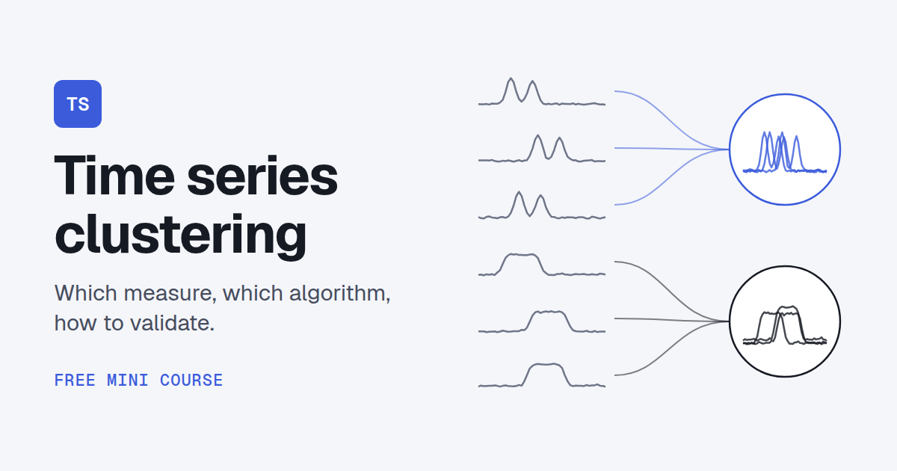

# Time series clustering

[](https://maxto.github.io/time-series-clustering/)

A short, free, operational course on clustering time series: 15 lessons along one pipeline, with formulas, a worked figure for each idea and a finance section in every measure lesson. Given a kind of data and a goal, it tells you which measure to use, which clustering algorithm fits that measure and how to validate the result. Written for data scientists and other technical readers.

**Read the course: https://maxto.github.io/time-series-clustering/**

## Contents

| # | Step | Lessons |
|---|---|---|
| 1 | [Define](https://maxto.github.io/time-series-clustering/same-series-different-questions/) | what similar means, what to ignore, z-normalisation, differencing, smoothing, resampling, missing values |
| 2 | [Measure](https://maxto.github.io/time-series-clustering/lock-step/) | lock-step distances, cross-correlation and SBD, DTW, Fréchet, GAK, LCSS, EDR, ERP, MSM, TWE, feature-based, model-based and complexity measures, shapelets and embeddings, multivariate series and subsequences |
| 3 | [Group](https://maxto.github.io/time-series-clustering/match-the-algorithm/) | partitioning, hierarchical, fuzzy, density-based and model-based clustering, and which algorithm fits which distance |
| 4 | [Validate](https://maxto.github.io/time-series-clustering/internal-indices/) | internal indices, external indices, stability |
| 5 | [Recipes](https://maxto.github.io/time-series-clustering/recipe-energy/) | daily load profiles, a stock universe |

Each measure lesson is a card: what it measures, when to use it, the definition with its formula, an example figure, which clustering algorithms fit, its empirical applications and limits in finance, and a common mistake. The course page (light or dark theme, search, progress, a filter of the measures by what they ignore) is built from the Markdown lessons in [content/](content/).

The figures use a small authored dataset of twelve daily demand profiles, [fixtures/demand-12.csv](fixtures/demand-12.csv). It shows what each choice does, it is not evidence that a method performs well.

This repository started as a catalogue of distances, algorithms and R packages. It is kept in [docs/original-list.md](docs/original-list.md), with the [original PDF](Time%20Series%20Clustering.pdf).

## Build

Requirements: Python 3.13 with [uv](https://docs.astral.sh/uv/) and Node.js. For the browser tests, Chrome.

```sh
uv sync && npm install
uv run python scripts/build.py --publish   # -> dist/index.html (open it in a browser)
uv run python scripts/figures.py           # regenerate the figures and their numbers
uv run pytest                              # build tests
npm test                                   # build + browser checks
```

## Licence

Code (scripts, page template, tests): [MIT](LICENSE). Course content (`content/`): [CC BY 4.0](content/LICENSE.md).

The content was written with AI assistance. Corrections are welcome: open an issue with the lesson and, where you can, a source.
