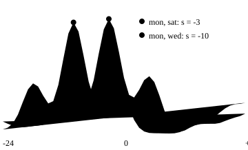

## One line

A sliding measure compares two series at every relative shift and keeps the shift where they match best, so it ignores a global lag and keeps everything else: the decisions are how to normalise and what to do at the ends.

## What it measures

Lock-step distance compares sample $t$ with sample $t$. Cross-correlation slides one series over the other, takes the inner product at each shift, and so asks how well the two shapes agree once one is moved by the best amount. The shape-based distance (SBD) of [Paparrizos and Gravano (2015)](https://doi.org/10.1145/2723372.2737793) turns the best match into a dissimilarity, and is the distance of the k-Shape clustering algorithm.

On the twelve days of the fixture, an authored demonstration, SBD on z-normalised days groups the six two-peak days together and the six flat-block days together, though early and late days differ by five hours. Euclidean distance on the same z-normalised days still splits early from late. The shift is what SBD forgives, and the normalisation is what lets it ignore level and scale.

The curve for `mon` and `sat` peaks at a shift of {{n:shift_mon_sat}} samples, the one for `mon` and `wed` at {{n:shift_mon_wed}}. SBD is one minus the height of the peak: {{n:sbd_mon_sat}} and {{n:sbd_mon_wed}}.

## When to use it

Use it when:

- The same pattern may start at a different moment in each series, and one lag describes the difference: recordings started at different times, a cycle with an arbitrary phase.
- Level and scale should not count. SBD is meant for z-normalised series.
- The set is large. One pair costs $O(m \log m)$ through the fast Fourier transform, for series of length $m$.

Avoid it when:

- The date itself matters. A good match at a large shift is a match between different times.
- Different parts of the series run early or late by different amounts. One shift serves the whole series. DTW lets timing vary inside it (see the lesson on `dtw`).
- Series have different lengths and the tool you use needs equal lengths, as `tslearn.clustering.KShape` does.

## Definition

For z-normalised $x, y$ of length $m$, shifting $y$ by $s$ samples and filling the gap with zeros, the cross-correlation at shift $s$ is the sum of products over the overlap:

$$
\begin{gathered}
\mathrm{CC}_s(x, y) = \sum_{t} x_t\, y_{t-s} \\[6pt]
s \in \{-(m-1), \dots, m-1\}
\end{gathered}
$$

Paparrizos and Gravano define three normalisations of it, the biased estimator, the unbiased estimator and the coefficient normalisation:

$$
\begin{aligned}
\mathrm{NCC}_b &= \frac{\mathrm{CC}_s}{m} \\[6pt]
\mathrm{NCC}_u &= \frac{\mathrm{CC}_s}{m - |s|} \\[6pt]
\mathrm{NCC}_c &= \frac{\mathrm{CC}_s}{\lVert x \rVert \, \lVert y \rVert}
\end{aligned}
$$

The distance uses the last one:

$$
\mathrm{SBD}(x, y) = 1 - \max_{s} \mathrm{NCC}_c(x, y)_s
$$

By the Cauchy-Schwarz inequality $\mathrm{NCC}_c$ cannot exceed 1, so the value lies between 0 and 2, and 0 means the same shape up to a shift. The cross-correlation for all shifts is computed with the fast Fourier transform, which reduces the cost from $O(m^2)$ to $O(m \log m)$.

::: deep Libraries count differently
`dtwclust::SBD` has `znorm = FALSE` by default and states that the distance works best on z-normalised series, so z-normalise yourself or set the argument. `aeon.distances.sbd_distance` has `standardize=True` by default. The R function documents that it relies on the fast Fourier transform, and its documentation warns that it can return different values on 32 bit and 64 bit installations. Check the normalisation and the treatment of the ends before you compare SBD numbers from two sources.
:::

## Normalisation and the ends

The real decision is what is normalised, because the best shift depends on it. In the example of Paparrizos and Gravano, two aligned series of length 1024 should need no shift. With no z-normalisation and the biased estimator the best shift is 773 samples to the left, with z-normalisation and the unbiased estimator it is 670 to the right, and only z-normalisation with the coefficient normalisation gives no shift. The example is synthetic.

Two further facts of the definition. The shifted series is padded with zeros, so a large shift compares a short overlap and the zeros are not data. And one shift applies to the whole series, so two events that move in opposite directions cannot both be aligned.

## Which clustering algorithm

SBD gives a pairwise distance matrix, and the algorithms differ in what else they need:

- **k-Shape.** The algorithm of the same paper. Like k-means, it alternates an assignment step, using SBD, with a refinement step, but the refinement computes the centre with a method built for SBD instead of the arithmetic mean: the centre is the eigenvector of the largest eigenvalue of a matrix built from the cluster aligned to a reference series. It expects equal-length series.
- **Agglomerative hierarchical.** Needs only the matrix, with single, complete or average linkage. The twelve-day example uses average linkage.
- **k-medoids.** Works on any dissimilarity matrix, and each centre is a real series (Kaufman and Rousseeuw, 1990).
- **DBSCAN.** Runs on a precomputed matrix (Ester et al., 1996), with its radius set on the SBD scale between 0 and 2.
- **k-means.** Built on Euclidean distance and the arithmetic mean as centre, which Paparrizos and Gravano replace with their shape extraction for SBD.

## In finance

SBD answers a question about shape up to a lag: which series follow the same path, one possibly earlier than the other. It is not a measure of same-date dependence, since the best match may come from a shift. For same-date dependence the literature offers several measures: Pearson correlation for linear association, the rank correlations of [Spearman (1904)](https://doi.org/10.2307/1412159) and [Kendall (1938)](https://doi.org/10.1093/biomet/30.1-2.81) for monotonic association, dynamic conditional correlation for time-varying dependence ([Engle, 2002](https://doi.org/10.1198/073500102288618487)), and copulas for dependence beyond correlation ([Embrechts, McNeil and Straumann, 2002](https://doi.org/10.1017/CBO9780511615337.008)). For lags that vary inside the series, DTW is an alternative (see the lesson on `dtw`).

Empirical applications:

- **Lead and lag, stocks.** [Lo and MacKinlay (1990)](https://doi.org/10.1093/rfs/3.2.175) study weekly US stock returns with cross-autocovariances, the lagged counterpart of what cross-correlation measures. They report that the returns of large stocks lead those of smaller stocks.
- **Lead and lag, clustering.** [Deng and Zhang (2026)](https://arxiv.org/abs/2608.24703) compare clustering algorithms for grouping stocks by lead-lag relationships, among them KShape, against a DTW-based baseline, with a trading strategy on synthetic and real stock data. The best Sharpe ratio under the lead strategy is reported for MiniRocket with k-means, not for KShape.

Limitations in financial time series:

- **Normalisation.** In the example above, the best shift depends on the normalisation of the series and of the cross-correlation (Paparrizos and Gravano, 2015). The example is synthetic and is not financial data.

## Common mistake

Using a sliding measure on raw values and reading the result as shape similarity. Without z-normalisation the best shift and the distance are driven by level and scale, and aligned series can be given a wrong shift. Z-normalise each series, use the coefficient normalisation, and report the shifts you allow.
