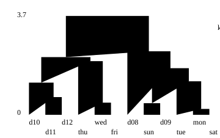
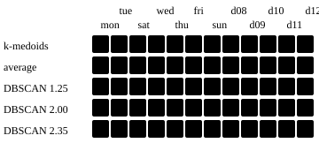

## One line

An algorithm is not neutral: it needs vectors, a distance matrix, a similarity matrix or the series themselves, and it assumes centres, a hierarchy, density or a probability model, so choose the distance first and then the algorithm that accepts it without changing its meaning.

## What each algorithm needs

Four kinds of input appear in the algorithms below.

- **Vectors.** One row per series, all of the same length, compared with the Euclidean distance. Algorithms that average, such as k-means, need this.
- **A distance matrix.** All pairwise dissimilarities from any measure of the Measure module, DTW included.
- **A similarity matrix.** The same, but large values mean close. Affinity propagation reads this.
- **The series.** The algorithm computes its own comparison inside, so it takes the series and not a matrix. k-Shape, TADPole and deep clustering are of this kind.

## When to use it

Use it when:

- You know the number of groups and want flat groups with a centre: partitioning.
- You want a tree to read at several levels, and the set is small enough for a dendrogram: hierarchical.
- A series may belong to several groups: fuzzy.
- The number of groups is unknown, some series should be left out as noise, or groups have any shape: density.
- You want a probability model of each group: model-based.

Avoid it when:

- The distance has no mean and the algorithm needs one. Averaging series under DTW has no meaning without a DTW-consistent average.
- The distance is not Euclidean and the criterion assumes it, as in Ward linkage.
- The set is large and the algorithm builds an all-pairs structure. Affinity propagation has time complexity of order $N^2 T$ for $T$ iterations and, with a dense similarity matrix, memory of order $N^2$ (`scikit-learn` documentation).

## The algorithms

For each algorithm: what it needs, how it works, what it suits. The references are to whoever developed the method.

**k-means** ([Lloyd, 1982](https://doi.org/10.1109/TIT.1982.1056489)). Needs vectors. It looks for $K$ centroids that minimise the within-cluster sum of squares. It alternates two steps, assigning each series to its nearest centroid and replacing each centroid by the mean of its members, until the centroids stop moving.

$$
\min_{\mu_1, \dots, \mu_K} \sum_{i=1}^{N} \min_{j} \lVert x_i - \mu_j \rVert^2
$$

It suits compact groups of similar spread. The criterion assumes convex and isotropic clusters and responds poorly to elongated ones, and in very high dimensions Euclidean distances inflate, so `scikit-learn` suggests reducing dimension first (general documentation, not specific to time series).

**k-medoids** (partitioning around medoids, PAM, [Kaufman and Rousseeuw, 1990](https://doi.org/10.1002/9780470316801)). Needs a distance matrix. CLARA, from the same authors, runs PAM on samples of the data for large sets. PAM searches $K$ series, the medoids, that minimise the sum of dissimilarities of every series to its nearest medoid. Because it sums dissimilarities and not squares, it is more robust than k-means, and every centre is a real series.

$$
\min_{M \subset \{1, \dots, N\},\ |M| = K} \sum_{i=1}^{N} \min_{m \in M} d(x_i, x_m)
$$

It suits any distance, including elastic ones. The exact PAM search costs of order $N K (N - K)^2$ (`aeon` documentation).

**k-Shape** ([Paparrizos and Gravano, 2015](https://doi.org/10.1145/2723372.2737793)). Needs the series, of equal length. It is a k-means loop with the shape-based distance (SBD) for assignment and a shape-extraction step for the centroid. SBD is one minus the largest normalised cross-correlation over all shifts $w$, with $R_0$ the cross-correlation at shift zero, and the centroid maximises the sum of squared correlations with the members of its cluster $P_k$:

$$
\begin{gathered}
\mathrm{NCC}_{\max}(x, y) = \max_{w} \frac{CC_w(x, y)}{\sqrt{R_0(x, x)\, R_0(y, y)}} \\[6pt]
\mathrm{SBD}(x, y) = 1 - \mathrm{NCC}_{\max}(x, y) \\[6pt]
\mu_k = \arg\max_{\mu} \sum_{x_i \in P_k} \mathrm{NCC}_{\max}(x_i, \mu)^{2}
\end{gathered}
$$

It suits groups that differ in shape when a global shift is allowed, with series z-normalised.

**TADPole** ([Begum et al., 2015](https://doi.org/10.1145/2783258.2783286)). Needs the series, univariate and of equal length. It is a density-peaks method ([Rodriguez and Laio, 2014](https://doi.org/10.1126/science.1242072)) under DTW, where centres are points denser than their neighbours and far from any denser point. A series is a neighbour of another if their DTW distance is below a cutoff $d_c$, and the local density counts the neighbours. DTW lower and upper bounds prune most of the comparisons.

$$
\rho_i = \left| \{ j \ne i : d_{\mathrm{DTW}}(x_i, x_j) < d_c \} \right|
$$

The centres are always members of the data, as in PAM, and the result is deterministic given $d_c$ (`dtwclust` documentation). It suits univariate series of equal length that must be compared with DTW when the cost of the full matrix is a concern.

**Affinity propagation** ([Frey and Dueck, 2007](https://doi.org/10.1126/science.1136800)). Needs a similarity matrix $s(i, k)$. Series exchange two messages, the responsibility $r(i, k)$ that $k$ should be the exemplar of $i$, and the availability $a(i, k)$ that $i$ should choose $k$. They are updated until convergence, with a damping factor, and the exemplars are real series.

$$
\begin{gathered}
r(i, k) \leftarrow s(i, k) - \max_{k' \ne k} \left[ a(i, k') + s(i, k') \right] \\[6pt]
a(i, k) \leftarrow \min\left[ 0,\ r(k, k) + \sum_{i' \notin \{i, k\}} r(i', k) \right]
\end{gathered}
$$

The number of clusters follows from the data and from the preference given to each series to be an exemplar. It suits small and medium sets with many clusters or uneven sizes. A distance has to be turned into a similarity first: the default of `scikit-learn` uses the negative squared Euclidean distance.

**Agglomerative hierarchical.** Needs a distance matrix, or vectors for Ward. Every series starts alone and the two closest groups are merged until one is left. The linkage defines closest: single, the closest pair of members. Complete, the farthest pair. Average, the mean over all pairs. Ward, the merge that least increases the within-cluster sum of squares.

$$
\begin{aligned}
d_{\mathrm{single}} &= \min_{a \in A,\, b \in B} d(a, b) \\[6pt]
d_{\mathrm{complete}} &= \max_{a \in A,\, b \in B} d(a, b) \\[6pt]
d_{\mathrm{average}} &= \frac{1}{|A||B|} \sum_{a \in A} \sum_{b \in B} d(a, b)
\end{aligned}
$$

It suits small sets where the tree itself is the result. Single linkage is not robust to noise, Ward gives the most regular sizes, and Ward and the centroid and median linkages are correctly defined only for Euclidean distances (`scikit-learn` and `scipy` documentation).

**Divisive hierarchical** (DIANA, Kaufman and Rousseeuw, 1990). Needs a distance matrix. It starts from one cluster and at each stage splits the one with the largest diameter, the largest dissimilarity between two of its members. The series with the largest average dissimilarity to the others starts a splinter group, and series closer to the splinter group than to the rest move to it (`cluster` documentation).

$$
\mathrm{diam}(C) = \max_{i, j \in C} d_{ij}
$$

It suits a top-down view of a small set, when the large groups matter more than the leaves.

**Fuzzy c-means** ([Bezdek et al., 1984](https://doi.org/10.1016/0098-3004(84)90020-7)). Needs vectors. Each series has a membership $u_{ij}$ in every cluster, non-negative and summing to one over the clusters, and the algorithm minimises a weighted sum of distances to the centres, with $m > 1$ the degree of fuzzification.

$$
\min_{U, c} \sum_{i=1}^{N} \sum_{j=1}^{K} u_{ij}^{m}\, \lVert x_i - c_j \rVert^2
$$

It suits series that sit between groups. A variant on a dissimilarity matrix exists, `cluster::fanny` in R. In high dimensions the centres can be pulled to the overall centre of gravity (`scikit-fuzzy` documentation).

**DBSCAN** ([Ester et al., 1996](https://cdn.aaai.org/KDD/1996/KDD96-037.pdf)). Needs a distance matrix or vectors. A core series has at least $\mathrm{MinPts}$ series within distance $\varepsilon$. A cluster is a set of core series reachable from one another through neighbours, plus the non-core series next to them. The rest is noise, and there is no $K$.

$$
\begin{gathered}
N_{\varepsilon}(p) = \{ q : d(p, q) \le \varepsilon \} \\[6pt]
p \text{ is core if } |N_{\varepsilon}(p)| \ge \mathrm{MinPts}
\end{gathered}
$$

It suits groups of any shape and uneven sizes, with outliers. $\varepsilon$ depends on the data and on the distance and usually cannot be left at a default (`scikit-learn` documentation), so it has to be set on the scale of the chosen measure.

**SNN clustering** ([Ertöz, Steinbach and Kumar, 2003](https://doi.org/10.1137/1.9781611972733.5)). Needs a distance matrix, from which it takes the $k$ nearest neighbours of each series. The similarity of two series is the number of neighbours they share, and the DBSCAN steps run on that similarity graph, with a threshold on the shared neighbours in place of $\varepsilon$ (`dbscan` documentation).

$$
s(i, j) = \left| \mathrm{kNN}(i) \cap \mathrm{kNN}(j) \right|
$$

It suits clusters of different sizes, shapes and densities in noisy, high-dimensional data, which is the problem named in the title of the paper.

**Gaussian mixtures** ([Fraley and Raftery, 2002](https://doi.org/10.1198/016214502760047131)). Needs vectors. Each group is a Gaussian with weight $\pi_k$, mean $\mu_k$ and covariance $\Sigma_k$, fitted by expectation-maximisation. A series goes to the component it most probably belongs to.

$$
p(x) = \sum_{k=1}^{K} \pi_k\, \mathcal{N}(x \mid \mu_k, \Sigma_k)
$$

It suits groups with different spreads and correlations, where k-means is the case of equal covariance. With too few series per component the covariance estimate becomes singular and the likelihood can diverge, and the number of components has to come from held-out data or an information criterion (`scikit-learn` documentation).

**Self-organising maps** ([Kohonen, 1990](https://doi.org/10.1109/5.58325)). Needs vectors. A grid of prototypes $m_i$ is trained one series $x(t)$ at a time: find the prototype $c$ closest to $x(t)$ and move $c$ and its grid neighbours towards it. The neighbourhood function $h_{ci}$ is 1 at $c$ and falls with the grid distance, and the learning rate $\alpha(t)$ and the radius shrink during training (Kohonen's article in Scholarpedia and the `kohonen` documentation).

$$
m_i(t+1) = m_i(t) + \alpha(t)\, h_{ci}(t) \left[ x(t) - m_i(t) \right]
$$

It suits an ordered map of the data, in which close prototypes are similar, and the units or groups of units become the clusters.

**Deep clustering.** Needs the series. A neural network learns a representation and the grouping together. Deep Temporal Clustering ([Madiraju et al., 2018](https://arxiv.org/abs/1802.01059)) joins an autoencoder with a temporal clustering layer and optimises reconstruction and clustering jointly. [Ma et al. (2019)](https://papers.nips.cc/paper_files/paper/2019/hash/1359aa933b48b754a2f54adb688bfa77-Abstract.html) combine a reconstruction objective with a k-means objective in a sequence-to-sequence model. Schematically, with $\lambda$ the weight of the clustering term:

$$
\mathcal{L} = \mathcal{L}_{\mathrm{reconstruction}} + \lambda\, \mathcal{L}_{\mathrm{clustering}}
$$

It suits cases where a learned representation is acceptable, as in the lesson on learned representations. The results reported by the authors are on their own benchmarks.

**Robust continuous clustering** ([Shah and Koltun, 2017](https://doi.org/10.1073/pnas.1700770114)). Needs vectors, so series enter as features or embeddings. It optimises a smooth global objective with numerical methods, and the authors report high accuracy across domains and scaling to large datasets.

::: deep Two parameters called eps
In DBSCAN, $\varepsilon$ is a radius on the distance. In SNN clustering, `eps` is a threshold on the number of shared neighbours, and the documentation notes it is different from the one in DBSCAN. A value tuned for one has no meaning for the other.
:::

## Matching the algorithm to the distance

Start from the distance, since it comes from the question, and read down to the algorithms that accept it. The lesson on DTW shows the case in detail.

- **Euclidean distance on vectors.** Every algorithm above accepts it, and k-means, fuzzy c-means, Gaussian mixtures and self-organising maps need it.
- **An elastic measure such as DTW.** It gives a matrix and no centre, and it is not a metric. Use k-medoids, hierarchical clustering with single, complete or average linkage, DBSCAN or SNN, or affinity propagation after a similarity is derived. k-means needs a DTW-consistent average such as DBA ([Petitjean, Ketterlin and Gançarski, 2011](https://doi.org/10.1016/j.patcog.2010.09.013)), the option offered by `tslearn`. TADPole works for univariate series of equal length.
- **SBD.** k-Shape uses it with its own centroid, or the SBD matrix can feed the matrix-based algorithms.
- **A learned representation.** The vectors can go to any algorithm that takes vectors.
- **A similarity.** Affinity propagation, or turn it into a distance for the others.

An algorithm that merely accepts a matrix does not make the result meaningful. Ward linkage accepts a precomputed matrix in `scipy`, but the result is correct only if the distances are Euclidean, and the user has to guarantee it.

Feed one matrix, DTW with $w = 4$ on the twelve fixture days, to three of these algorithms. The fixture is an authored demonstration, so this shows what each input does, not which algorithm is better.

The tree keeps every level. Its last merge is at height {{n:merge_last}} and the one before at {{n:merge_prev}}, so any cut between the two gives two groups.

k-medoids at two groups, with medoids `{{n:medoid_a}}` and `{{n:medoid_b}}`, gives the same partition as average linkage. DBSCAN takes a radius in place of a number of groups. With MinPts 3 it leaves {{n:dbscan_noise_small}} days as noise at radius 1.25, returns the same two groups at 2.00, and joins all twelve at 2.35.

## In finance

Clustering answers which assets or periods group together under the chosen measure, for instance to pick diversifiers or candidates for pairs. It does not prove that groups exist, and the groups depend on the measure and the algorithm. For the question of how assets move together through time, the literature offers several tools: Pearson correlation for linear association, the rank correlations of [Spearman (1904)](https://doi.org/10.2307/1412159) and [Kendall (1938)](https://doi.org/10.1093/biomet/30.1-2.81) for monotonic association, dynamic conditional correlation for time-varying dependence ([Engle, 2002](https://doi.org/10.1198/073500102288618487)), copulas for dependence beyond correlation ([Embrechts, McNeil and Straumann, 2002](https://doi.org/10.1017/CBO9780511615337.008)), and the minimal spanning tree of the correlation matrix of [Mantegna (1999)](https://doi.org/10.1007/s100510050929).

Empirical applications:

- **Hierarchical, stocks.** [Mantegna (1999)](https://arxiv.org/abs/cond-mat/9802256) builds a graph of stocks from the correlation matrix of daily log-price differences and reads the hierarchical tree of its subdominant ultrametric as an economic taxonomy of the stocks.
- **k-means, stocks.** [Mattera, Scepi and Kaur (2025)](https://doi.org/10.1007/s00500-025-10656-2) compare time series clustering techniques for portfolio selection on monthly series of stocks of the Russell index and of the Dow Jones Industrial Average, with k-means as the base case. They evaluate the portfolios out of sample.
- **k-means and DBSCAN, stocks.** [Ashrafzadeh, Sadrani and Zolfani (2025)](https://doi.org/10.1016/j.rineng.2025.106263) group large-cap NYSE stocks with DTW, k-means and DBSCAN, train return forecasters on each cluster and report that the models with clustering outperform the same models without.
- **k-medoids and k-Shape, stocks.** [Deng and Zhang (2026)](https://arxiv.org/abs/2608.24703) compare DTW with k-medoids against k-Shape, MiniRocket with k-means and an ensemble, to cluster stocks by lead-lag relationships on synthetic and real data. They report a Sharpe ratio of 0.866 and a maximum drawdown of -63.9% for the best performer under the lead strategy, MiniRocket with k-means.
- **Fuzzy, stocks.** [D'Urso, De Giovanni and Massari (2021)](https://doi.org/10.1007/s10479-019-03284-1) cluster multivariate series of FTSE MIB stocks with a fuzzy partitioning-around-medoids method on a DTW distance, with a trimming step for outliers.
- **Affinity propagation, stocks and crypto-assets.** [Kitanovski et al. (2024)](https://arxiv.org/abs/2408.11739) apply affinity propagation and the Louvain method to correlation networks of S&P 500 stocks and 203 crypto-assets from 2019 to 2022 and build diversified portfolios from the communities. They report that some earlier findings for traditional stock markets hold, while the crypto-asset market shows an opposing trend.
- **Model-based, stock indices.** [Dias, Vermunt and Ramos (2015)](https://doi.org/10.1016/j.ejor.2014.12.041) cluster returns of 21 European stock markets with a regime-switching latent class model. They find two clusters of markets and three regimes, bull, bear and a stable one.
- **Self-organising maps, equities.** [Gafiychuk, Datsko and Izmaylova (2004)](https://doi.org/10.1016/j.physa.2004.04.115) map the Dow Jones index components for 2002 and 2003 with a self-organising map and analyse the clusters further with the group method of data handling.
- **Deep clustering, stocks and indices.** [Cen et al. (2022)](https://doi.org/10.3390/fi14110331) cluster stocks of the CSI 300 and S&P 500 with a temporal convolutional autoencoder and a KL divergence clustering objective, and report that the clusters can identify stocks that perform well or poorly. [Tavakoli et al. (2020)](https://arxiv.org/abs/2004.07296) cluster 70 stock indices by labels derived from series characteristics such as volatility and train an autoencoder to predict them, with 87.5% accuracy on unseen series.

Limitations in financial time series:

- **Length of the series.** When clustering by correlation, series that are too short can give spurious clusters, and series that are too long can smooth out changes in dynamics ([Marti et al., 2016](https://arxiv.org/abs/1603.04017)).
- **Stylised facts.** Volatility clustering and the non-Gaussian, asymmetric and heavy-tailed densities of returns complicate clustering, and prices, being integrated, call for returns (Mattera et al., 2025).
- **Sensitivity to the number of clusters.** DTW with k-medoids has high computational cost, weak mathematical properties of the distance and sensitivity to the number of clusters, as stated for lead-lag clustering of stocks (Deng and Zhang, 2026).
- **Euclidean geometry.** Ward linkage and the centroid-based linkages are correct only with Euclidean distances (`scipy` documentation). The statement is general.
- **Singular covariance.** A Gaussian mixture with too few series per component can have an infinite-likelihood solution unless the covariance is regularised (`scikit-learn` documentation). The statement is general.

## Common mistake

Handing a DTW or SBD matrix to an algorithm that assumes Euclidean geometry, such as Ward linkage, because the software accepts it, or averaging series with the arithmetic mean under an elastic distance. The program runs and the result has no meaning. Start from the distance, check what the algorithm needs and assumes, and keep the pair consistent.
